# DSO202 Practical 4 Report: GitOps with Argo CD

In this practical I followed the GitOps and Argo CD lab guide. In class we covered the four GitOps principles (declarative, versioned and immutable, pulled automatically, continuously reconciled) and the three main Argo CD parts (the API server, the repo server and the application controller), and started the install. I finished the install, connected Argo CD to a GitHub repo, and tested scaling, self heal and pruning, all on my dso202 kind cluster.

## Cluster and Argo CD install

I used the same dso202 cluster as my other practicals, with 3 nodes Ready.

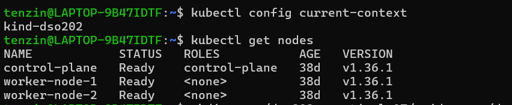

In class, `kubectl apply` of the install manifest created almost everything, but failed on the ApplicationSet CRD with "metadata.annotations: Too long". When I checked, all 7 Argo CD Pods were running, but only 2 of the 3 CRDs existed, and the applicationset controller had restarted 153 times because its CRD was missing.

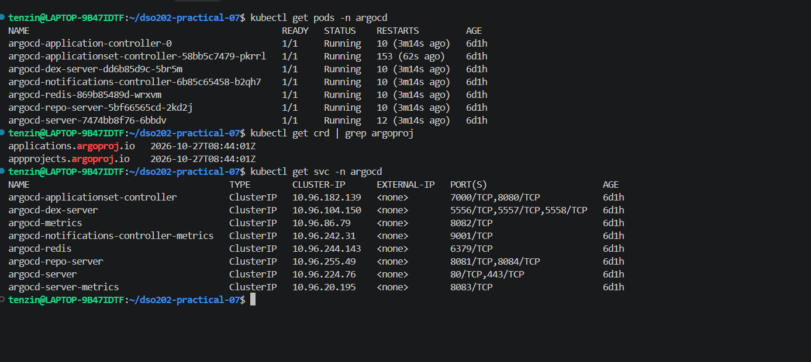

Normal `kubectl apply` stores a full copy of every object in the `last-applied-configuration` annotation, and the ApplicationSet CRD is too big for the 256 KB annotation limit. I applied the same manifest again with `--server-side --force-conflicts`, which does not store that copy, and all 3 CRDs installed.

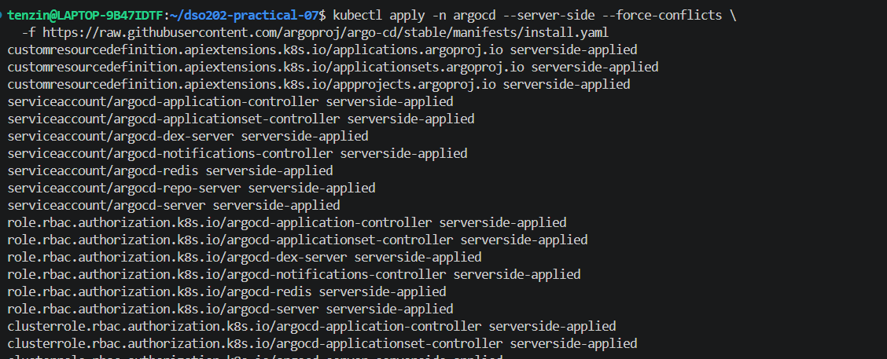
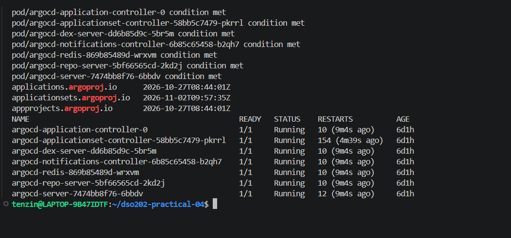

## Dashboard

I read the initial admin password from the `argocd-initial-admin-secret` Secret (I did not screenshot it), port forwarded the `argocd-server` Service to localhost:8080 and logged in. The browser showed a "Not secure" warning because Argo CD uses a self signed certificate.

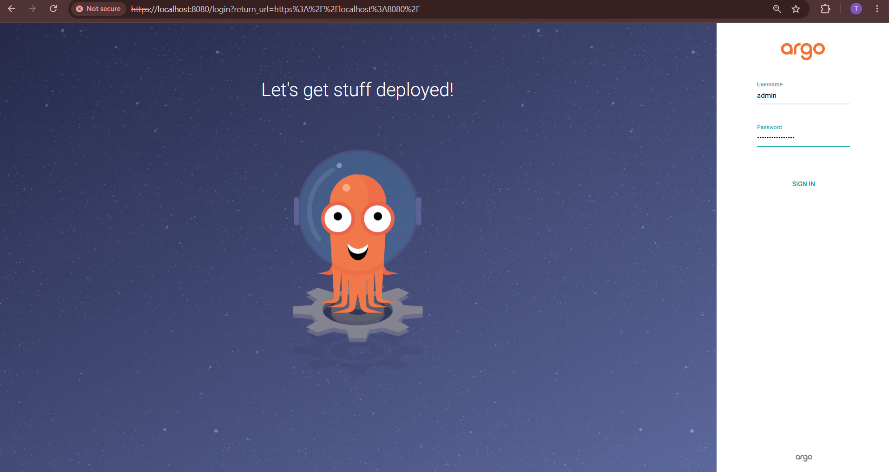
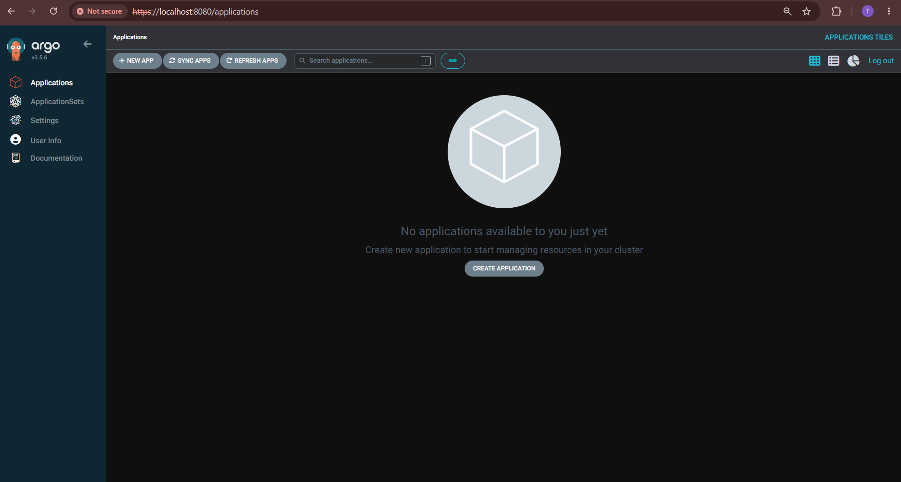

## The desired state in GitHub

I created the public repo `dso202-gitops-demo` with a README, and pushed `manifests/deployment.yaml` (`nginxdemos/hello:plain-text`, 2 replicas) and `manifests/service.yaml` (ClusterIP on port 80). The lab guide creates the repo as `dso202-gitops-demo` but later clones and points the Application at `k8s-gitops-demo`, so I used `dso202-gitops-demo` everywhere to avoid a ComparisonError.

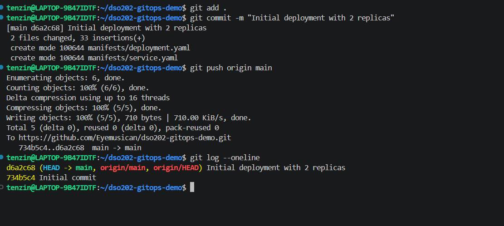

## Registering the Application

I wrote `argocd-app.yaml` as an Argo CD `Application` in the `argocd` namespace. It points at the `manifests` folder of my repo, deploys to the `demo-app` namespace, and has automated sync with `prune` and `selfHeal`, plus `CreateNamespace=true`. After `kubectl apply`, the `my-webapp` tile showed Healthy and Synced about 6 seconds later, without me applying the manifests myself. The two Pods landed on different worker nodes.

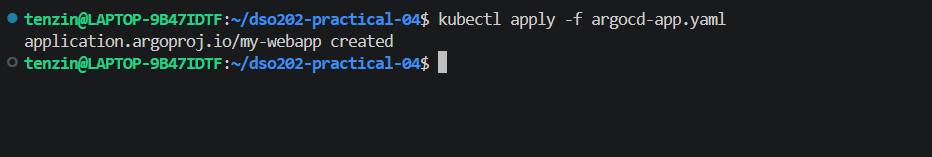
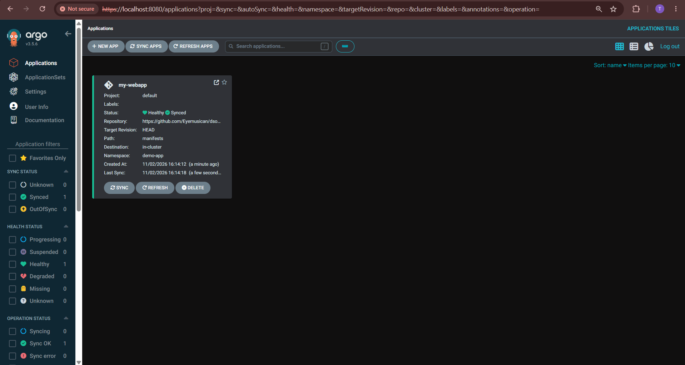
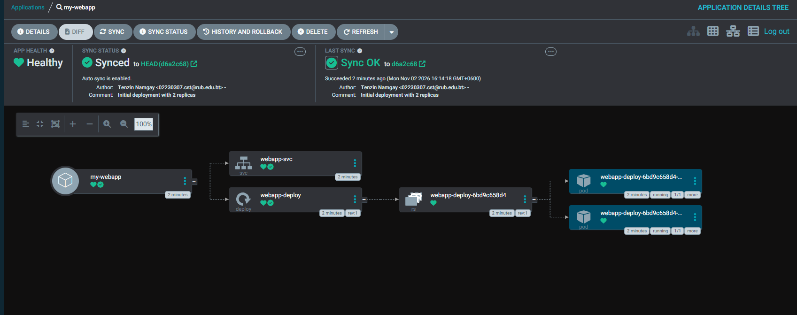
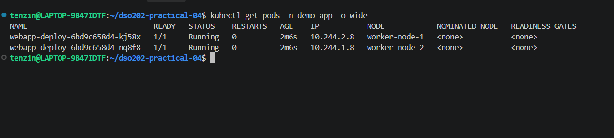

## Experiment 1: scaling through Git

I changed `replicas` from 2 to 4 in `deployment.yaml` and pushed it as commit `14a8502`. After a refresh, Argo CD synced to that commit, showed my name and the commit message, and added 2 Pods to the same ReplicaSet. The 4 Pods were split 2 and 2 across the worker nodes.

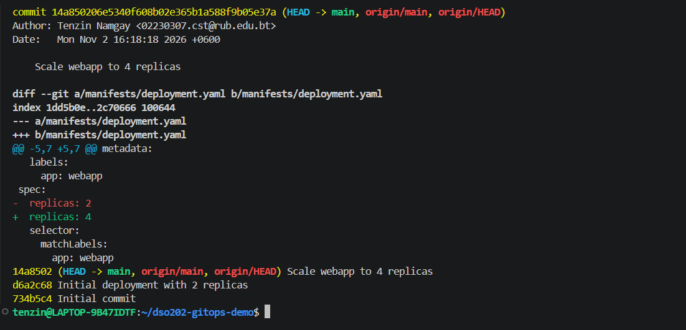
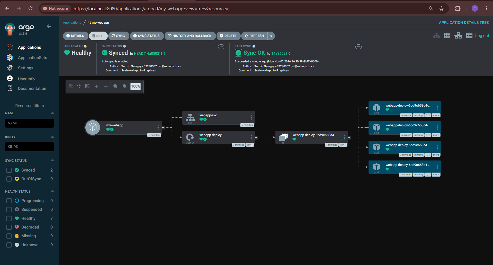
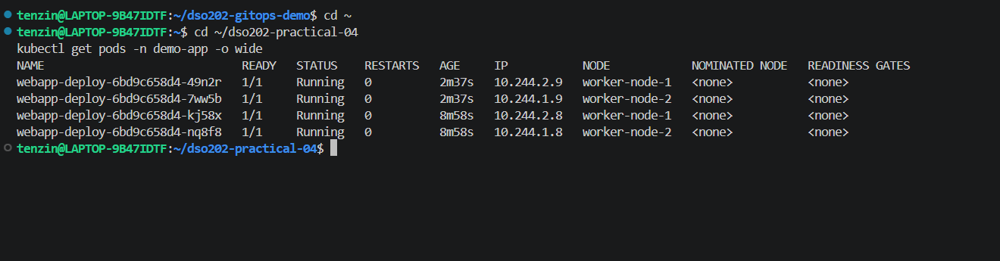

## Experiment 2: drift and self heal

I scaled the Deployment to 1 replica with `kubectl`, which made the cluster differ from Git. Within seconds Argo CD set it back to 4, and the Deployment went from 1/1 to 1/4 to 4/4. In the tree, 3 Pods were new and 1 was older, the one that survived. The last sync time updated but stayed on commit `14a8502`, since Git had not changed.

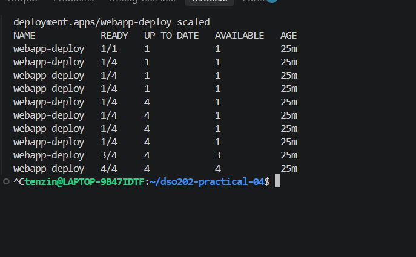
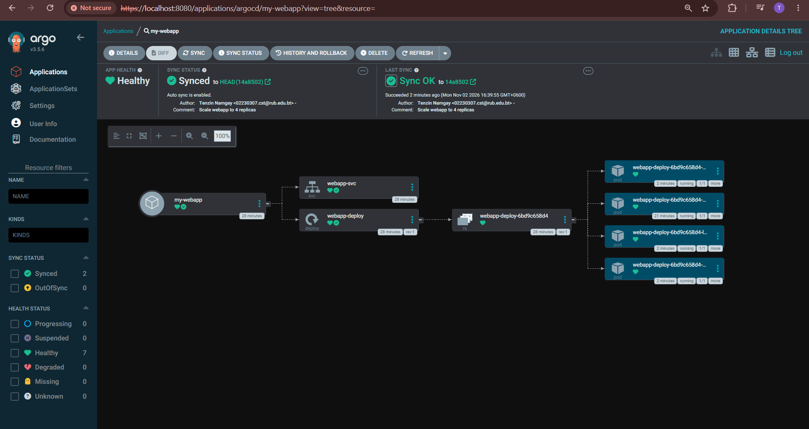

## Experiment 3: pruning

I deleted `service.yaml` with `git rm` and pushed commit `e5faf14`. Argo CD removed `webapp-svc` from the cluster, because `prune` is enabled.

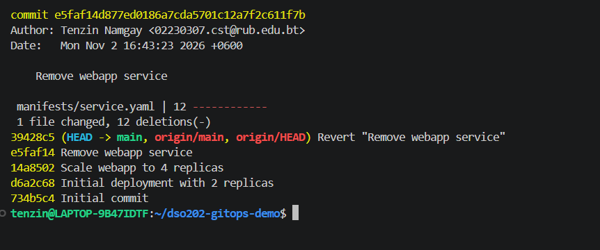
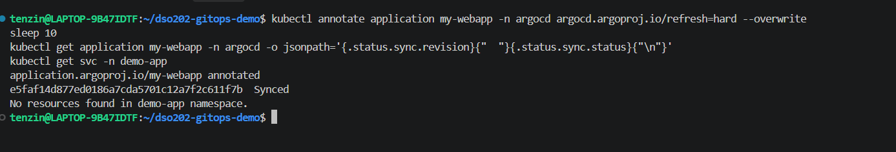
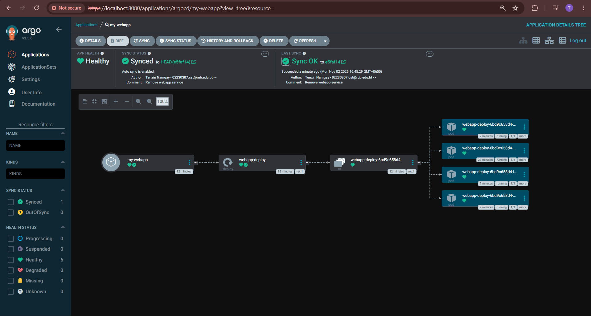

Then I ran `git revert HEAD`, which made a new commit `39428c5` that adds `service.yaml` back. Argo CD created the Service again with a new ClusterIP, and the history still shows both the removal and the revert.

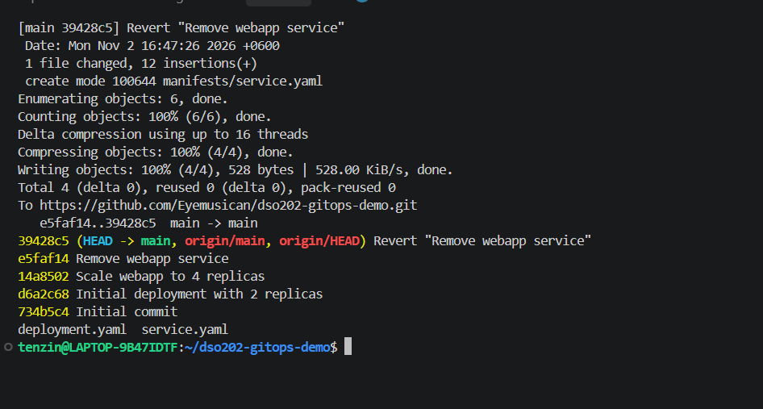
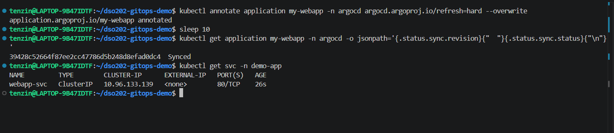
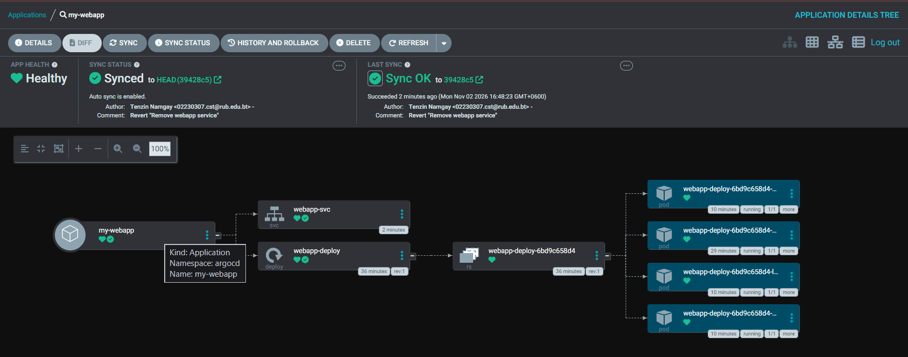

The sync history lists each Git change after the first deploy with its commit, author and message, and every one was started by the automated sync policy.

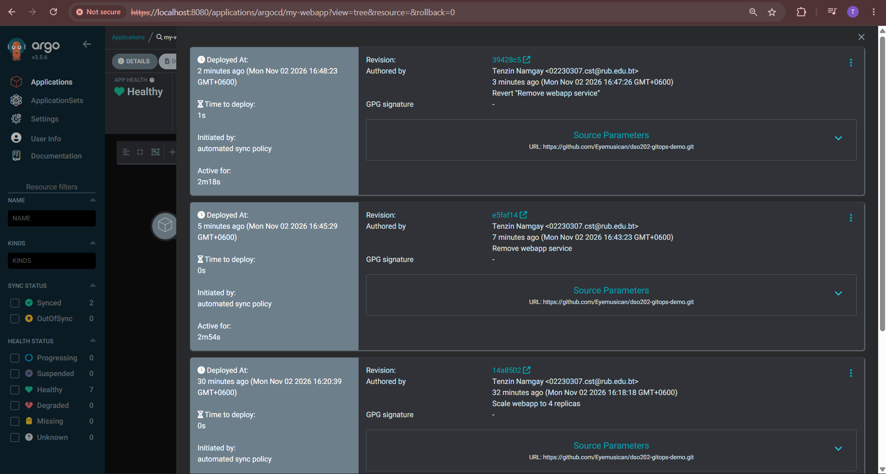

## Cleanup

The lab guide ends with `kind delete cluster`, but that would delete my whole cluster, including my other coursework. Instead I deleted only the Application and the `demo-app` namespace, and kept Argo CD installed.

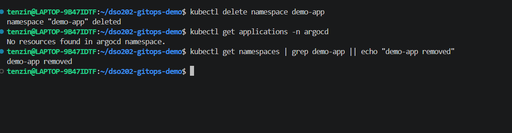

## Problems I ran into and how I solved them

**The ApplicationSet CRD failed to install.** The normal `kubectl apply` from class failed with "metadata.annotations: Too long", so Argo CD was only partly installed and the applicationset controller kept restarting. Applying the same manifest with `--server-side --force-conflicts` fixed it.

**The lab guide uses two repo names.** It says to create `dso202-gitops-demo` but uses `k8s-gitops-demo` in the clone command and in `argocd-app.yaml`. I used `dso202-gitops-demo` in both places, otherwise Argo CD could not have found the repo.

**Refresh did not pick up the prune commit.** After I pushed `e5faf14`, Argo CD still showed commit `14a8502` and the Service, even after I clicked Refresh. I forced a hard refresh by adding the `argocd.argoproj.io/refresh=hard` annotation to the Application, and within 10 seconds it synced to `e5faf14` and removed the Service. I used the same hard refresh for the revert.

**Deleting the Application would have left the app running.** My Application had no resources finalizer, so deleting it would only remove the Application and leave the Deployment, Pods and Service. I added `resources-finalizer.argocd.argoproj.io` before deleting, so Argo CD removed everything it had deployed. Kubernetes printed a warning about the finalizer name format, but the cleanup worked. I then deleted `demo-app` myself, since Argo CD creates it with `CreateNamespace` but does not delete it.

**The lab cleanup would delete my whole cluster.** `kind delete cluster --name dso202` would remove every other assignment and practical running on it, so I only removed what this practical created.

## What I learned

GitOps made Git the only place I changed the app. Scaling, removing a resource and rolling back were all commits, and Argo CD applied each one by itself, so the commit history became the deployment history. Self heal showed that a manual `kubectl` change does not last when Git is the source of truth, and prune showed that deleting a file is enough to delete the resource. I also saw why the lab keeps the manifests in their own repo, since every commit there is a real change to the cluster.
